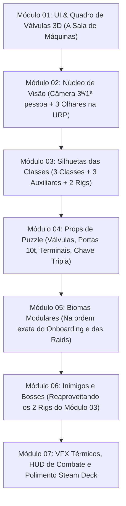

# Roteiro de Componentes Visuais — Ordem de Produção da Diretoria de Game Design

**Estúdio:** HTL Games
**Diretório do Projeto Visual (Unity 6 LTS):** `client/parallax-unity/Assets/_Project/`
**Filosofia de Produção:** *Gameplay First & Vertical Slice Driven*

---

## 1. Resposta da Diretoria de Game Design: Devemos criar os Biomas logo após o Menu Beta?

**Não diretamente — e este é o segredo para não estourar o orçamento de US\$ 2.000 nem retrabalhar cenários.**

Em um jogo 3D de puzzles assimétricos ([[matriz-de-paralaxe]]), **um bioma não pode ser modelado no escuro antes de termos três coisas prontas**:
1. **A Câmera em 3ª/1ª pessoa e os 3 Olhares (`Settings/Rendering/` e `Shaders/Vision/`):** toda a paleta e a iluminação de um bioma mudam drasticamente conforme quem olha: o [[goliath]] (visão térmica/pressão), o [[phantom]] (contorno ótico ciano) ou o [[cipher]] (malha de dados desaturada). Se criarmos o bioma sem os Olhares, teremos que refazer texturas e luzes depois.
2. **A Escala Métrica das 3 Classes (`Art/Characters/`):** um corredor ou duto só tem a altura certa se soubermos o tamanho exato da cápsula do Goliath erguendo uma porta de 10 toneladas e o alcance máximo do cabo de tensão do Phantom.
3. **O Kit de Props de Puzzle (`Art/Props/` e `Prefabs/`):** antes de decorar uma Cidade-Radiador, precisamos das peças que fazem o jogo funcionar: o volante hidráulico da [[therma-tek]], a [[chave-tripla]], a Linha Viva com faixa amarela e o Farol de laser.

Por isso, a **Ordem Oficial de Produção Visual** segue **7 Módulos Sequenciais**, onde cada módulo destrava o próximo sem retrabalho:



---

## 2. Árvore do Diretório Visual (`client/parallax-unity/Assets/_Project/`)

O projeto Unity 6 LTS está em `client/parallax-unity/` e se configura pelo menu `Parallax/Bootstrap` (URP com um renderer por Olhar, Input System, Localization e gravidade de gameplay).

```text
Assets/_Project/
├── Data/                                   # ScriptableObjects e dados gerados
│   ├── Classes/ Auxiliaries/ Corporations/ # Goliath, Phantom, Cipher · Macaco, Pipa, Cartucho · Therma-Tek, Kinesys, Omni-Cripto
│   ├── Weapons/ Relics/ Missions/          # Arsenal, Relíquias de Grau-Zero, válvulas do Quadro (seed em Missions/Seed)
│   ├── Thermal/ Session/ Camera/           # Perfis térmicos, escala de sessão (1 a 3), perfis de câmera por classe
│   ├── Lore/Generated/ · Lore/Fragments/   # fragments.json do sync_daedalus.py · LoreFragment importados
│   └── Localization/Source/                # daedalus_strings.csv (PT-BR, EN, ZH-CN, ES)
├── Scripts/                                # Core · Networking · Gameplay · Rendering · UI · Editor (Assembly Definitions)
├── Shaders/
│   ├── Vision/                             # GoliathThermal, PhantomOptic, CipherNet, FrostBorder (tela cheia)
│   └── World/                              # HeatShimmer (vapor sulfúrico nas grelhas)
├── Art/
│   ├── UI/                                 # Logos, válvulas, relógios, retratos de rádio, moldura do Override
│   ├── Textures/                           # Chapa de aço de Tritão, LUT térmico, ruído da Ômega
│   ├── Characters/                         # Goliath, Phantom, Cipher e os 2 Rigs (Humanoid)
│   ├── Auxiliaries/ Weapons/ Props/        # Macaco, Pipa, Cartucho · Canhão de Escória · Porta 10t, Válvula Mestra, Linha Viva
│   ├── Environment/FossoDeHefesto/         # Viga I, texturas PBR, decalques, céu da Face Voltada
│   ├── Enemies/                            # Esquadra de Contenção
│   └── Materials/                          # Materiais dos Olhares e de laboratório
├── Audio/                                  # Mixers · Beat · Radio · Ambience
├── Prefabs/                                # Characters · Props · World · Session
├── Scenes/                                 # Boot (rede) · Labs (Lab_Olhares) · Missions
├── Settings/                               # Rendering (Parallax_URP + 4 renderers) · Input · Localization
└── Tests/EditMode/                         # Termodinâmica, Batida, escala de sessão, Fila de Comando, Três Mãos
```

Os arquivos-fonte que não entram no build ficam fora de `Assets/`: os `.blend` em `art-pipeline/source/blender/`.

---

## 3. Detalhamento de Cada Etapa do Roteiro Visual

### Etapa 1 — O Menu Beta e o Quadro de Válvulas (UI diegética 3D)
Por que começamos aqui:
- **Valida a identidade visual e sonora inteira do jogo** antes de gastar tempo com geometria pesada.
- Serve como **protótipo vivo da Paralaxe**: as 3 camadas do mapa (Física/Goliath, Espacial/Phantom, Lógica/Cipher) ensinam ao jogador e aos investidores o conceito central do jogo em 10 segundos.

**Entregáveis Visuais do Módulo 01:**
1. **Sala de Máquinas ([[menu-principal]]):**
   - Logotipo `PARALLAX` em duas chapas metálicas desalinhadas que deslizam e travam com estalo mecânico ao primeiro input.
   - Geada procedural (`Parallax/Vision/FrostBorder`, no renderer neutro) que cresce das bordas quando o controle fica parado e recua ao menor input.
   - 6 interruptores rotativos industriais: **Quadro**, **Esquadra**, **Forja**, **Sinal**, **Linha** e **Ajustes**.
2. **Quadro de Válvulas ([[quadro-de-valvulas]] — o "Diretor" de Tritão, `ValveBoardController`):**
   - Chapa de aço 3D com dutos ligando os 5 biomas (Fosso em vermelho-ferrugem, Krios-Prime invertida no topo em violeta, Estilhaços em anel ciano, Agulha em raio branco, Cemitério apagado), cada missão um volante físico (`ValveNode`).
   - As 3 camadas de leitura são planos reais em profundidade que deslizam em paralaxe; em cooperativo, cada jogador vê a própria camada.
   - A Nota do Piso (40–60 Hz) muda de altura com o calor do setor selecionado.
   - Os **3 Relógios do Fim** no topo (`140 ANOS`, `--`, `--`) e as **Três Mãos** (`TriHandsLaunch`: todos seguram confirmar por `0,4 s`, ajustável, para girar a válvula e lançar a missão).
3. **Ficha de Incursão ([[ficha-de-incursao]]):**
   - Folha de serviço diegética que surge ao girar o volante, com o briefing de [[candeia]], os ícones de escalabilidade (1, 2 ou 3 jogadores + Auxiliares) e a recompensa em [[nucleo-termico]].

---

### Etapa 2 — Núcleo de Visão (Câmera e os 3 Olhares)
Antes de modelar qualquer parede, criamos a "câmera de teste" do jogo (cena `Scenes/Labs/Lab_Olhares`):
1. **Câmera em 3ª pessoa com 1ª pessoa contextual (`ParallaxCameraRig` + Cinemachine 3):** enquadramento por classe (`CameraProfile`: Goliath mais aberto, Phantom com viés vertical) e passagem suave para a 1ª pessoa ao ler um manômetro, mirar ou operar um terminal.
2. **Os 3 Olhares (um Universal Renderer por classe, `Parallax_URP`):**
   - `Parallax/Vision/GoliathThermal`: mapa de calor sobre dutos pressurizados e ondas de tremor no piso no ritmo da Batida.
   - `Parallax/Vision/PhantomOptic`: contorno ciano de alta visibilidade em vigas superiores, ganchos e códigos no teto.
   - `Parallax/Vision/CipherNet`: mundo físico desaturado com a Pele de Rede, **Tremor Vermelho** na Contagem de Vazamento e o terminal isolado do **Override Cego**.

---

### Etapa 3 — Caixa Cinza de Escala e 2 Rigs (`Art/Characters/`)
Criamos os bonecos de escala (*greybox/low-poly*) para calibrar a altura de todas as portas e plataformas:
1. **`Rig_Bipede_Pesado`:** esqueleto largo e pesado para o **Goliath** (`2,6 m` de altura), com IK de mãos (Animation Rigging) para portas e volantes.
2. **`Rig_Bipede_Padrao`:** esqueleto ágil para o **Phantom** e o **Cipher** (`1,8 m` de altura).
3. **Malhas Low-Poly no Blockbench (`Art/Auxiliaries/`):** o **Macaco** (esteira + garra hidráulica), a **Pipa** (drone-olho com cabo) e o **Cartucho de Override**.

---

### Etapa 4 — As Peças do Labirinto (`Art/Props/` e `Prefabs/`)
Com a altura das classes definida, modelamos via **Blender MCP** e **Blockbench** os objetos que aparecem em todas as missões:
1. **Volante Hidráulico e Porta de Chumbo de 10 t** (`HeavyDoor`: `Rigidbody` de 10.000 kg com `ConfigurableJoint`, sustentada pelo Goliath ancorado ou pelo Macaco).
2. **Porta da [[chave-tripla]]** (`TripleLockPuzzle` + 3 `LockActuator`, com os 3 selos corporativos + o **Quarto Receptáculo vazio** sem selo).
3. **Linha Viva** (`LiveLine`: tubulação com faixa amarela e manômetro cravado em `140%` que trava as armas dos soldados do Sindicato).
4. **Terminal da Omni-Cripto e Mastro de Farol da Kinesys** (`OverrideTerminal`, `GrapplePoint`).

---

### Etapa 5 — A Ordem Correta dos Biomas (`Scenes/Missions/`)
Agora sim entramos nos **Biomas**, blocados em **ProBuilder**, detalhados com kits do **Blender** e texturizados no **Material Maker**, seguindo a ordem em que o jogador os desbloqueia e a necessidade do **Vertical Slice (Marco M1)**:

| Ordem de Produção | Bioma | Por que nesta ordem? |
| --- | --- | --- |
| **1º Bioma** | Fosso de Hefesto | É o palco da **Quest 1** ([[quest-01-calor-de-contrabando]] — nossa Demo e Vertical Slice do Mês 6) **e** da **Raid 1** ([[sangria-de-hefesto]]). Um único kit modular de aço enferrujado, grelhas, válvulas gigantes e magma resolve a primeira missão e a primeira Raid inteira. |
| **2º Bioma** | Hub (Acampamento) | O [[acampamento-da-resistencia]] reaproveita 70% das peças de dutos do Fosso de Hefesto, adicionando apenas a bancada da Forja, a Oficina de Auxiliares e a mesa física do Quadro de Válvulas. |
| **3º Bioma** | Estilhaços | Palco da **Quest 2** ([[quest-02-linha-de-visada]] — segunda metade da Demo do Steam Next Fest). Introduz o shader de gelo de nitrogênio, partículas de nevasca, gêiseres e a visão da **Face Voltada** com Netuno gigante no céu. |
| **4º Bioma** | Krios-Prime | Palco da **Quest 3** ([[quest-03-chave-tripla]]). Arquitetura brutalista limpa e invertida, luz neon violeta e janelas da **Face Cega** mostrando apenas estrelas. |
| **5º Bioma** | Cemitério das Máquinas | Palco da **Raid 2** ([[meta-atingida]] — Update 1). Custo de cenário baixíssimo: escuridão quase total, feixes de lanterna e pilhas de carcaças geradas por IA e reduzidas no Blender. |
| **6º Bioma** | Transportes | As 3 arenas móveis ([[expresso-maglev]], [[funiculares-de-fosso]] e o Rastejador *Vagalume*) que multiplicam as incursões repetíveis usando os kits visuais dos biomas 1, 3 e 4. |
| **7º Bioma** | Agulha do Zênite | Reservado para o Endgame / DLC *A Travessia*. |

---

### Etapa 6 e 7 — Inimigos, Bosses, VFX e HUD
- **Inimigos sem retrabalho:** as [[esquadras-de-contencao]] vestem o mesmo `Rig_Bipede_Padrao` do Phantom/Cipher; o **Mestre de Fornalha**, o **Regulador de Brandt** e o **Gestor-9** vestem o mesmo `Rig_Bipede_Pesado` do Goliath. Drones da Ômega andam por NavMesh.
- **VFX de Choque Térmico e HUD:** partículas de vapor, congelamento e estilhaçamento de placas incandescentes a 38 K, fechando o ciclo visual para rodar a 60 FPS cravados no PC e no Steam Deck.
