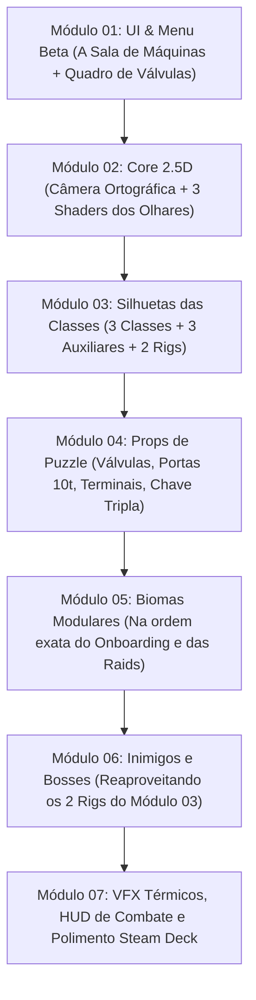

# Roteiro de Componentes Visuais — Ordem de Produção da Diretoria de Game Design

**Estúdio:** HTL Games
**Diretório do Projeto Visual (Godot 4.4+):** `client/parallax/`
**Filosofia de Produção:** *Gameplay First & Vertical Slice Driven*

---

## 1. Resposta da Diretoria de Game Design: Devemos criar os Biomas logo após o Menu Beta?

**Não diretamente — e este é o segredo para não estourar o orçamento de US\$ 2.000 nem retrabalhar cenários.**

Em um jogo 2.5D de puzzles assimétricos ([[matriz-de-paralaxe]]), **um bioma não pode ser modelado no escuro antes de termos três coisas prontas**:
1. **A Câmera Ortográfica 2.5D e os 3 Shaders de Olhar (`02_core_shaders_e_camera/`):** Porque toda a paleta de cores e iluminação de um bioma em PARALLAX muda drasticamente dependendo se quem está olhando é o [[goliath]] (visão térmica/pressão), o [[phantom]] (contorno ótico ciano) ou o [[cipher]] (malha de dados desaturada). Se criarmos o bioma sem os shaders, teremos que refazer as texturas e luzes depois.
2. **A Escala Métrica das 3 Classes (`03_classes_e_auxiliares/`):** Um corredor ou duto só tem a altura certa se soubermos o tamanho exato da cápsula do Goliath erguendo uma porta de 10 toneladas e a distância máxima do cabo de tensão do Phantom.
3. **O Kit de Props de Puzzle (`04_props_e_interativos_puzzles/`):** Antes de decorar uma Cidade-Radiador, precisamos das peças que fazem o jogo funcionar: o volante hidráulico da [[therma-tek]], a [[chave-tripla]], a Linha Viva com faixa amarela e o Farol de laser.

Por isso, a **Ordem Oficial de Produção Visual** segue **7 Módulos Sequenciais**, onde cada módulo destrava o próximo sem retrabalho:



---

## 2. Árvore do Diretório Visual (`client/parallax/`)

Toda a estrutura física já foi criada no repositório sob `client/parallax/` (configurada para abrir diretamente no Godot 4.4+ com **Jolt Physics** ativado e gravidade ajustada para Tritão):

```text
client/parallax/
├── project.godot                              # Projeto Godot 4.4+ pré-configurado (1920x1080, Jolt Physics)
├── data/
│   └── lore/                                  # Recebe fragments.json exportado por studio/scripts/sync_daedalus.py
├── 01_ui_menu_beta/                           # MÓDULO 01 (Foco Inicial): Menu Principal e Diretor de Missões
│   ├── scenes/                                # MainMenuSalaDeMaquinas.tscn, QuadroDeValvulas.tscn, FichaDeIncursao.tscn
│   ├── scripts/                               # Controle de paralaxe de 3 camadas, lógica das "Três Mãos", Relógios do Fim
│   ├── shaders/                               # frost_border.gdshader (geada que avança se o controle ficar parado)
│   └── assets/                                # Chapa de aço escuro, volantes vetoriais (Inkscape), fontes estêncil
├── 02_core_shaders_e_camera/                  # MÓDULO 02: A Lente Assimétrica 2.5D
│   ├── shaders/                               # goliath_thermal.gdshader, phantom_optic.gdshader, cipher_net.gdshader
│   ├── scenes/                                # OrthoCamera25D.tscn (Câmera ortográfica com 3 planos de profundidade)
│   └── scripts/                               # ThermalNode.gd, BeatSequencer.gd (A Batida em 50 Hz)
├── 03_classes_e_auxiliares/                   # MÓDULO 03: Os Operadores e Rigs Compartilhados
│   ├── goliath/                               # Rig_Bipede_Pesado.glb, malha exo industrial, escudo térmico
│   ├── phantom/                               # Rig_Bipede_Padrao.glb, traje vácuo, cabo de tensão, camuflagem
│   ├── cipher/                                # Rig_Bipede_Padrao.glb, manoplas quânticas, tela 2D de Override
│   └── auxiliares/                            # Macaco.glb, Pipa.glb, CartuchoOverride.glb (Blockbench)
├── 04_props_e_interativos_puzzles/            # MÓDULO 04: A Mecânica Física no Cenário
│   ├── valvulas_e_portas/                     # Volantes Therma-Tek, Porta de Chumbo 10t, Eclusa da Chave Tripla
│   ├── terminais_e_farois/                    # Terminal Omni-Cripto, Mastro de Farol Kinesys, Quarto Receptáculo
│   └── linhas_vivas_e_relogios/               # Dutos amarelos (Fogo Mínimo), Manômetros 140%, Relógios (140, 60, 23 anos)
├── 05_biomas_modulares/                       # MÓDULO 05: Os Biomas (Ordem Estabelecida pelo Arco de Quests/Raids)
│   ├── 01_fosso_de_hefesto/                   # 1º Bioma (Quest 1 + Raid 1): Industrial vermelho, fumaça, magma
│   ├── 02_hub_acampamento/                    # 2º Bioma (Hub): Duto aquecido, Forja, Oficina de Auxiliares
│   ├── 03_estilhacos/                         # 3º Bioma (Quest 2): Gelo a -235°C, gêiseres, tempestade de cristais
│   ├── 04_krios_prime/                        # 4º Bioma (Quest 3): Neon violeta invertido, vidro, céu de estrelas
│   ├── 05_cemiterio_das_maquinas/             # 5º Bioma (Raid 2): Escuridão total, pilhas de mechas, sensores Ômega
│   ├── 06_agulha_do_zenite/                   # 6º Bioma (DLC/Endgame): Vácuo, gravidade zero, docas das Arcas
│   └── 07_transportes/                        # Arenas móveis: Expresso-Maglev, Funiculares de Fosso, Rastejador Vagalume
├── 06_inimigos_e_bosses/                      # MÓDULO 06: Forças do Sindicato e da Diretriz Ômega
│   ├── esquadras_de_contencao/                # Usa Rig_Bipede_Padrao (trava de tiro perto de Linha Viva)
│   ├── automatos_omega/                       # Drones caçadores, Guardião de Linha
│   └── bosses_raid/                           # Usa Rig_Bipede_Pesado: Mestre de Fornalha, Regulador (Brandt), Gestor-9
└── 07_vfx_e_hud_combate/                      # MÓDULO 07: Feedback Tátil e Visual
    ├── termico_e_criogenico/                  # Vapor pressurizado, estilhaçamento por Choque Térmico, arco EMP
    └── hud_classes/                           # Medidor de carga das Células Térmicas, Contagem de Vazamento, Fila de Comando
```

---

## 3. Detalhamento de Cada Etapa do Roteiro Visual

### Etapa 1 — `01_ui_menu_beta/` (O Menu Beta e o Quadro de Válvulas)
Por que começamos aqui:
- **Valida a identidade visual e sonora inteira do jogo em 2D** antes de gastar tempo com geometria 3D pesada.
- Serve como **protótipo vivo da Paralaxe**: as 3 camadas do mapa (Física/Goliath, Espacial/Phantom, Lógica/Cipher) já ensinam ao jogador e aos investidores o conceito central do jogo em 10 segundos.

**Entregáveis Visuais do Módulo 01:**
1. **`MainMenuSalaDeMaquinas.tscn` ([[menu-principal]]):**
   - Logotipo `PARALLAX` em duas chapas metálicas desalinhadas que deslizam e travam com estalo mecânico ao pressionar qualquer tecla.
   - Shader `frost_border.gdshader`: geada procedural nas bordas da tela que cresce em direção ao centro quando o mouse/controle fica inativo e derrete ao menor input.
   - 6 interruptores rotativos industriais: **Quadro**, **Esquadra**, **Forja**, **Sinal**, **Linha** e **Ajustes**.
2. **`QuadroDeValvulas.tscn` ([[quadro-de-valvulas]] — O "Diretor" de Tritão):**
   - Esquema de dutos em chapa de aço escuro conectando os 5 biomas (Fosso em vermelho-ferrugem, Krios-Prime invertida no topo em violeta, Estilhaços em anel ciano, Agulha em raio branco, Cemitério apagado).
   - Alternância em tempo real entre as 3 camadas de leitura com deslocamento de paralaxe.
   - Os **3 Relógios do Fim** no topo (`140 ANOS`, `--`, `--`) e o mecanismo das **Três Mãos** no canto inferior direito (segurar confirmar por `0.4s` para girar a válvula e lançar a missão).
3. **`FichaDeIncursao.tscn` ([[ficha-de-incursao]]):**
   - Folha de serviço diegética que desliza ao girar o volante de uma missão, mostrando o briefing de [[candeia]], os ícones de escalabilidade (1, 2 ou 3 jogadores + Auxiliares) e a recompensa em [[nucleo-termico]].

---

### Etapa 2 — `02_core_shaders_e_camera/` (A Lente Assimétrica 2.5D)
Antes de modelar qualquer parede, criamos a "câmera de teste" do jogo:
1. **Câmera Ortográfica 2.5D (`OrthoCamera25D.tscn`):** Define o ângulo exato de visão lateral com profundidade para 3 faixas de piso (plano frontal, plano de combate principal e plano de fundo/dutos).
2. **Os 3 Shaders de Classe (`.gdshader`):**
   - `goliath_thermal.gdshader`: Mapa de calor sobre dutos pressurizados e ondas de tremor no piso.
   - `phantom_optic.gdshader`: Contorno ciano de alta visibilidade em vigas superiores, ganchos e códigos no teto.
   - `cipher_net.gdshader`: Mundo físico desaturado com cabos de dados pulsantes + efeito de **Tremor Vermelho** para a Contagem de Vazamento.

---

### Etapa 3 — `03_classes_e_auxiliares/` (Caixa Cinza de Escala e 2 Rigs)
Criamos os bonecos de escala (*greybox/low-poly*) para calibrar a altura de todas as portas e plataformas:
1. **`Rig_Bipede_Pesado.glb`:** Esqueleto largo e pesado para o **Goliath** (`2.6m` de altura).
2. **`Rig_Bipede_Padrao.glb`:** Esqueleto ágil para o **Phantom** e o **Cipher** (`1.8m` de altura).
3. **Malhas Low-Poly no Blockbench (`auxiliares/`):** O **Macaco** (esteira + garra hidráulica), a **Pipa** (drone-olho com cabo) e o **Cartucho de Override**.

---

### Etapa 4 — `04_props_e_interativos_puzzles/` (As Peças do Labirinto)
Com a altura das classes definida, modelamos via **Blender MCP** e **Blockbench** os objetos que aparecem em todas as missões:
1. **Volante Hidráulico e Porta de Chumbo de 10 t** (com `HingeJoint3D`).
2. **Porta da [[chave-tripla]]** (com os 3 selos corporativos + o **Quarto Receptáculo vazio** sem selo).
3. **Linha Viva** (tubulação com faixa amarela e manômetro cravado em `140%` que trava as armas dos soldados do Sindicato).
4. **Terminal da Omni-Cripto e Mastro de Farol da Kinesys**.

---

### Etapa 5 — `05_biomas_modulares/` (A Ordem Correta dos Biomas)
Agora sim entramos nos **Biomas**, construídos em **TrenchBroom + FuncGodot** e texturizados no **Material Maker**, seguindo estritamente a ordem em que o jogador os desbloqueia e a necessidade do **Vertical Slice (Marco M1)**:

| Ordem de Produção | Pasta do Bioma | Por que nesta ordem? |
| --- | --- | --- |
| **1º Bioma** | `01_fosso_de_hefesto/` | É o palco da **Quest 1** ([[quest-01-calor-de-contrabando]] — nossa Demo e Vertical Slice do Mês 6) **e** da **Raid 1** ([[sangria-de-hefesto]]).Um único kit modular de aço enferrujado, grelhas, válvulas gigantes e magma resolve a primeira missão e a primeira Raid inteira! |
| **2º Bioma** | `02_hub_acampamento/` | O [[acampamento-da-resistencia]] reaproveita 70% das peças de dutos do Fosso de Hefesto, adicionando apenas a bancada da Forja, a Oficina de Auxiliares e a mesa física do Quadro de Válvulas. |
| **3º Bioma** | `03_estilhacos/` | Palco da **Quest 2** ([[quest-02-linha-de-visada]] — segunda metade da Demo do Steam Next Fest). Introduz o shader de gelo de nitrogênio, partículas de nevasca, gêiseres e a visão da **Face Voltada** com Netuno gigante no céu. |
| **4º Bioma** | `04_krios_prime/` | Palco da **Quest 3** ([[quest-03-chave-tripla]]). Arquitetura brutalista limpa e invertida, luz neon violeta e janelas da **Face Cega** mostrando apenas estrelas. |
| **5º Bioma** | `05_cemiterio_das_maquinas/` | Palco da **Raid 2** ([[meta-atingida]] — Update 1). Custo de cenário baixíssimo: escuridão quase total, feixes de lanterna e pilhas de carcaças geradas por IA e reduzidas no Blender. |
| **6º Bioma** | `07_transportes/` | As 3 arenas móveis ([[expresso-maglev]], [[funiculares-de-fosso]] e o Rastejador *Vagalume*) que multiplicam as incursões repetíveis usando os kits visuais dos biomas 1, 3 e 4. |
| **7º Bioma** | `06_agulha_do_zenite/` | Reservado para o Endgame / DLC *A Travessia*. |

---

### Etapa 6 e 7 — `06_inimigos_e_bosses/` e `07_vfx_e_hud_combate/`
- **Inimigos sem retrabalho:** As [[esquadras-de-contencao]] vestem o mesmo `Rig_Bipede_Padrao` do Phantom/Cipher; o **Mestre de Fornalha**, o **Regulador de Brandt** e o **Gestor-9** vestem o mesmo `Rig_Bipede_Pesado` do Goliath.
- **VFX de Choque Térmico e HUD:** Partículas de vapor, congelamento e estilhaçamento de placas incandescentes a 38 K, fechando o ciclo visual para rodar a 60 FPS cravados no PC e no Steam Deck.
